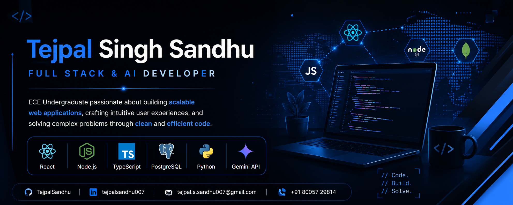
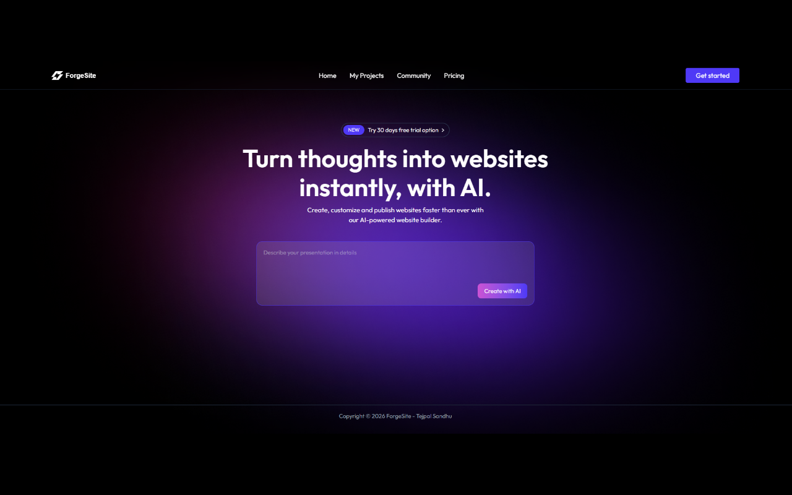
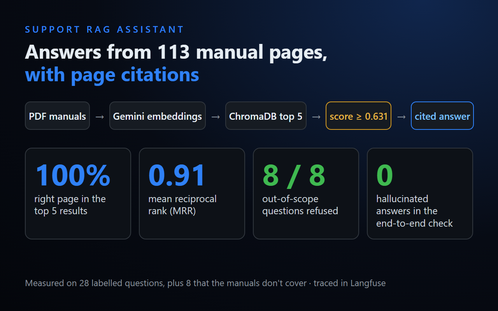
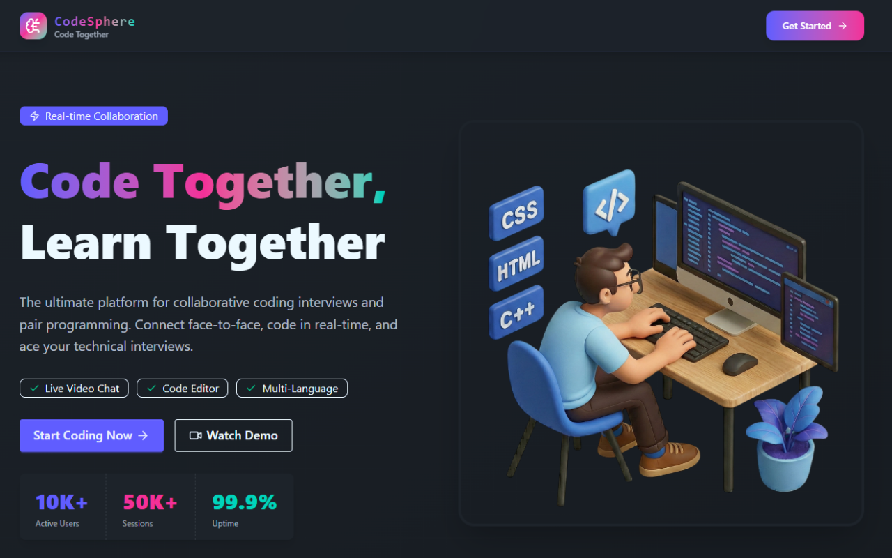
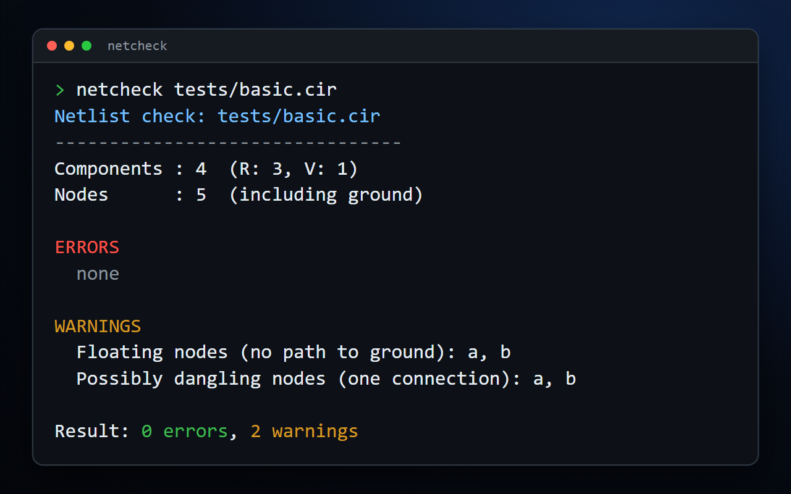

  

 

<h1 align="center">
Hi, I'm <b>Tejpal Singh Sandhu</b> 👋
</h1>

<h3 align="center">
Full Stack & AI Developer
</h3>

I build full-stack web apps and LLM-powered tools, with a focus on clean backends and AI features I can measure.

ECE @ TIET, Class of 2027 • Backend Enthusiast • Problem Solver

 

---

# 👨🏻‍💻 About

I'm an **Electronics & Communication Engineering undergraduate** at **Thapar Institute of Engineering & Technology**, graduating in **June 2027**.

I build web products end to end and add AI features where they help: an AI website builder with billing and version history, and a RAG support assistant whose retrieval I measured on a labelled test set before tuning it.

- 🎓 B.E. Electronics & Communication Engineering @ TIET (2023 – 2027)
- 💻 Full stack with React, TypeScript, Node.js, Express, PostgreSQL and MongoDB
- 🤖 AI engineering: RAG pipelines, vector search, LLM evaluation and tracing
- ⚙️ C++ and graph algorithms, applied to circuit netlists
- 📚 Practising DSA and system design (HLD & LLD)

---

# 🚀 Highlighted Projects

Projects that best represent my work across full-stack development, AI and systems programming.

 

<table>
<tr>
<td width="50%" valign="top">

### 🤖 ForgeSite AI

AI website builder: describe a site in one prompt, get a responsive page, then refine it by chatting with the AI or clicking elements to edit them.

- Two-stage LLM pipeline (prompt enhancement → HTML generation) runs in the background; credits are refunded automatically if generation fails
- Version history with rollback, iframe visual editor, phone / tablet / desktop preview, community publishing and HTML download
- 8-model PostgreSQL schema with Prisma, 13 REST endpoints, Better Auth sessions and Stripe webhooks for 3 credit plans

**Tech Stack**

`React` • `TypeScript` • `Tailwind CSS` • `shadcn/ui` • `Node.js` • `Express` • `PostgreSQL` • `Prisma` • `Better Auth` • `OpenRouter` • `Stripe`

</td>

<td width="50%" valign="top">

### 🧠 Support RAG Assistant

Customer-support assistant that answers questions from 113 pages of 3D-printer manuals with page citations, and says so when the manuals don't cover a question.

- Gemini embeddings in a persistent ChromaDB index; content-hashed chunk IDs mean re-runs only embed new or changed text
- Compared 5 chunk settings on 28 labelled questions (100% hit@5, MRR 0.91) and cut the prompt context from 12 to 5 chunks
- Similarity threshold + grounded prompt refused 8 of 8 out-of-scope questions with 0 hallucinated answers; every request is traced in Langfuse

**Tech Stack**

`Python` • `Gemini API` • `ChromaDB` • `Langfuse` • `pypdf`

</td>
</tr>

<tr>
<td width="50%" valign="top">

### 🚀 CodeSphere

Platform for 1-on-1 technical interviews: video call, chat, a Monaco code editor and code execution in one room.

- Runs JavaScript, Python, Java and C++ through the Judge0 API and checks the output against each problem's expected result
- 7 REST endpoints behind Clerk auth; Clerk JWTs are sent as bearer tokens so the Vercel frontend and Render backend work across domains
- 2 Inngest event-driven functions keep users in sync across Clerk, MongoDB and Stream

**Tech Stack**

`React` • `Tailwind CSS` • `daisyUI` • `TanStack Query` • `Node.js` • `Express` • `MongoDB` • `Clerk` • `Stream SDK` • `Judge0` • `Inngest`

</td>

<td width="50%" valign="top">

### ⚡ Netlist Connectivity Checker

C++17 command-line tool that checks SPICE-style circuit netlists for connectivity problems and input errors.

- Models the circuit as a graph (nodes as vertices, components as edges) and finds floating nodes with a breadth-first search from ground
- Reports malformed lines, unsupported components, invalid values (SPICE suffixes like `10k`, `1meg`) and duplicate names, each with its line number
- Parser, graph and report are separate modules covered by 30 unit tests; exit codes make it usable in scripts

**Tech Stack**

`C++17` • `g++` • `Graph algorithms`

</td>
</tr>
</table>

### 🧩 More Projects

- **[CartPole AI](https://github.com/TejpalSandhu/CartPole_AI)**: Deep Q-Network agent that learns to balance a pole, with a FastAPI backend and a Streamlit dashboard for live training, playback, analytics and dual-agent and hurdle modes. `Python` • `PyTorch` • `Gymnasium` • `FastAPI` • `Streamlit`
- **[Dynamic CV Builder](https://github.com/TejpalSandhu/cv-application)** ([live demo](https://tejpalsandhu.github.io/cv-application/)): resume builder with live preview, customization and PDF export. `React` • `JavaScript` • `CSS`

---

# ⚙️ Technologies

<table>
<tr>
<td valign="top" width="50%">

### 💻 Languages

**Also:** SQL

</td>
<td valign="top" width="50%">

### 🎨 Frontend

**Also:** TanStack Query • shadcn/ui • daisyUI • Monaco Editor

</td>
</tr>

<tr>
<td valign="top">

### ⚙️ Backend

- REST API design
- Auth: Clerk, Better Auth, JWT
- Payments: Stripe Checkout & webhooks
- Real-time: WebSockets, Stream video & chat SDK
- Background jobs: Inngest

</td>
<td valign="top">

### 🗄️ Databases & ORM / ODM

- PostgreSQL • MongoDB • MySQL
- ChromaDB (vector database)
- Prisma • Mongoose • Sequelize

</td>
</tr>

<tr>
<td valign="top">

### 🤖 AI / ML

- RAG, embeddings & vector search
- LLM evaluation (hit@k, MRR) & guardrails
- LLM tracing with Langfuse
- Gemini API • OpenRouter
- Deep Q-Learning (PyTorch, Gymnasium)

</td>
<td valign="top">

### 🛠️ Tools & Platforms

- Claude Code
- Render

</td>
</tr>

<tr>
<td valign="top">

### 🧠 CS Fundamentals
- Data Structures & Algorithms
- Object-Oriented Programming
- DBMS • Operating Systems • Computer Networks
- System Design (HLD & LLD)

</td>
<td valign="top">

### 📚 Currently Exploring
- Docker
- AWS
- CI/CD
- Hybrid search & re-ranking for RAG

</td>
</tr>
</table>

---

# 📈 GitHub Analytics

---

# 🤝 Let's Connect

&nbsp;&nbsp;&nbsp;&nbsp;&nbsp;&nbsp;

<i>Thanks for visiting my profile! Feel free to explore my repositories or connect with me.</i>

